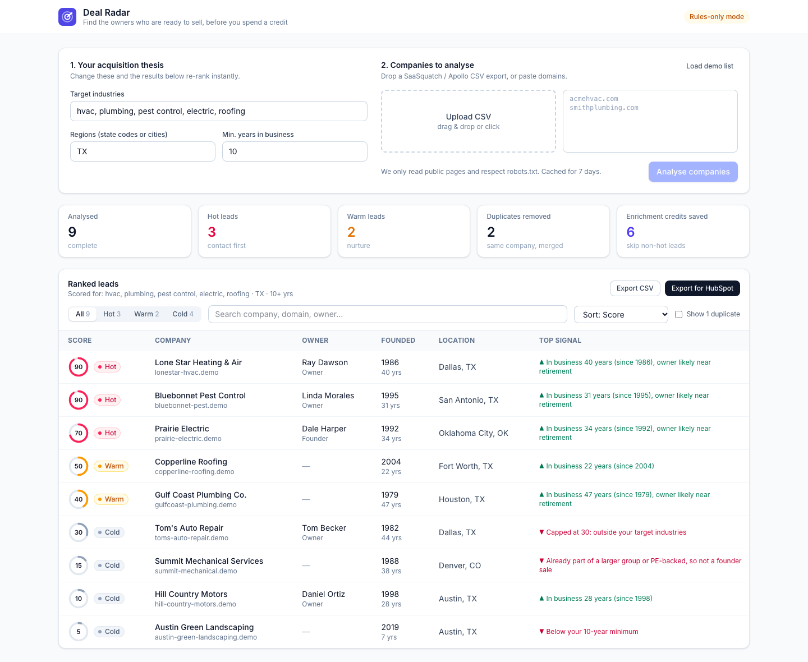
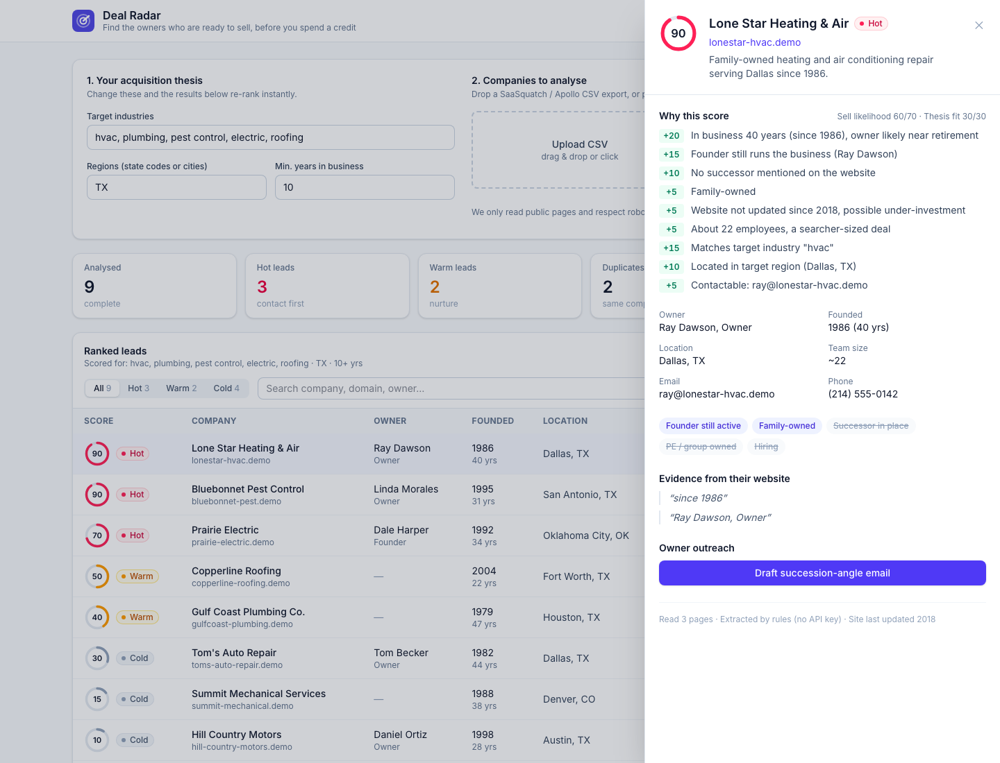

# Deal Radar

**Find the owners who are ready to sell, before you spend an enrichment credit.**

Deal Radar is a lead-scoring add-on for [SaaSquatch Leads](https://www.saasquatchleads.com/). You give it a list of companies (for example a SaaSquatch export). It reads each company's website, extracts succession signals, and ranks every company by how likely its owner is to sell. Every score comes with the reasons behind it.

| | |
|---|---|
| 🎥 **Video walkthrough** | _[add link]_ |
| 🌐 **Live demo** | _[add link]_ |
| 📦 **Repository** | _[add link]_ |



**Contents:**
[1. Setup](#1-setup) · [2. Dataset](#2-dataset) · [3. The problem](#3-the-problem) · [4. Features](#4-features) · [5. How scoring works](#5-how-scoring-works) · [6. Architecture](#6-architecture-and-tech-stack) · [7. API](#7-api) · [8. Responsible data collection](#8-responsible-data-collection) · [9. Known limitations](#9-known-limitations) · [10. Roadmap](#10-roadmap)

---

## 1. Setup

### Prerequisites
- **Node.js 22.13 or newer** (uses Node's built-in SQLite). Check with `node -v`.
- **npm** (comes with Node).
- *Optional:* an **Anthropic API key** for AI extraction. Without one, the app runs in rules-only mode and the demo still works fully.

### Install and run

```bash
# 1. Get the code
git clone <repo-url>
cd Caprae

# 2. Start the API (terminal 1)
cd server
npm install
cp .env.example .env        # optional: put your ANTHROPIC_API_KEY in .env
npm run dev                 # → http://localhost:4000

# 3. Start the web app (terminal 2)
cd web
npm install
npm run dev                 # → http://localhost:5173
```

### Try it in 30 seconds
1. Open **http://localhost:5173**.
2. Click **Load demo list**, then **Analyse 11 companies**.
3. Watch the table fill in live. Click any row to see **why** it scored that way.
4. Change **Target industries** to `cars`. The list re-ranks instantly and *Tom's Auto Repair* jumps to the top.
5. Click **Export for HubSpot** to download the ranked list.

### Environment variables (`server/.env`)

| Variable | Default | Purpose |
|---|---|---|
| `ANTHROPIC_API_KEY` | _(empty)_ | Enables Claude extraction and email drafting. Leave empty for rules-only mode. |
| `CLAUDE_MODEL` | `claude-opus-5-5` | Model used for extraction and outreach. |
| `PORT` | `4000` | API port. |
| `CORS_ORIGIN` | `http://localhost:5173` | Comma-separated origins allowed to call the API. |

For a production frontend build, set `VITE_API_URL` (e.g. `https://api.example.com`) before `npm run build` in `web/`.

### Check that it's working
```bash
curl http://localhost:4000/api/health
# {"ok":true,"mode":"heuristic","model":null,"claudeError":null}
```
The badge in the app header shows the same thing: **Rules-only mode** (no key), **AI extraction on**, or **AI unavailable, using rules** (key set but API calls failing; hover over it for the reason).

### Troubleshooting

| Symptom | Fix |
|---|---|
| Red banner: *"Can't reach the API"* | The API isn't running. Start `npm run dev` in `server/`. |
| `Error: No such built-in module: node:sqlite` | Your Node is too old. Install Node 22.13+. |
| `EADDRINUSE: address already in use :4000` | Something else uses port 4000. Stop it (`lsof -i :4000`), or set `PORT` in `.env` and update the proxy in `web/vite.config.ts`. |
| Header says *"AI unavailable, using rules"* | Hover over the badge for the API error (e.g. no credits). The app keeps working with rule-based extraction. |
| Want a clean slate | Stop the API and delete `server/data/` (cache and saved jobs). It is recreated on start. |

### Project structure

```
Caprae/
├── server/                 Node + Express API
│   ├── src/
│   │   ├── index.ts        API routes
│   │   ├── jobs.ts         Runs a batch: crawl → extract → enrich → score; live re-scoring
│   │   ├── crawler.ts      Fetches homepage + About/Team/Contact pages, robots.txt, caching
│   │   ├── extract.ts      Claude structured extraction + rule-based fallback
│   │   ├── enrich.ts       Email-domain (MX) check, phone formatting, duplicate detection
│   │   ├── score.ts        Explainable scoring rules
│   │   ├── outreach.ts     Succession-angle email drafts
│   │   ├── export.ts       Standard and HubSpot CSV export
│   │   ├── db.ts           SQLite storage (cache, jobs, leads)
│   │   └── types.ts        Shared schemas (Zod)
│   ├── fixtures/           Fictional demo websites (see Dataset)
│   └── Dockerfile
├── web/                    React + Vite + Tailwind dashboard
│   └── src/components/     SetupPanel, LeadsTable, LeadDrawer, UI primitives
├── sample-data/            Input and output datasets
└── docs/                   Screenshots
```

---

## 2. Dataset

### What's included

| File | Type | Description |
|---|---|---|
| [`sample-data/demo-companies.csv`](sample-data/demo-companies.csv) | **Input** | 11 rows: the demo list loaded by the **Load demo list** button. Includes one deliberately repeated row. |
| [`sample-data/demo-results.csv`](sample-data/demo-results.csv) | **Output** | The ranked result of analysing that list (thesis: HVAC, plumbing, pest control, electric, roofing in TX, 10+ years). |
| [`sample-data/demo-results-hubspot.csv`](sample-data/demo-results-hubspot.csv) | **Output** | The same results in HubSpot's import format. |
| [`server/fixtures/`](server/fixtures/) | **Source websites** | 10 fictional company websites (home, about and contact pages) that the demo list points to. |

### Why the dataset is fictional

The included companies are **made up**. Their `.demo` domains don't exist on the internet, and any resemblance to real businesses is coincidental. This is deliberate:

- **Permissibility:** shipping data scraped from real businesses (owner names, emails, phone numbers) in a public repository would republish personal contact data without consent and could breach website terms. A fictional dataset avoids this entirely.
- **Reproducibility:** the demo gives **identical results on every machine**, offline, with no risk of a real website changing, going down or blocking the crawler.
- **Coverage:** each fictional company was written to trigger **one specific scoring scenario**, so a reviewer can verify every rule.

When the crawler sees a `.demo` domain, it reads the pages from `server/fixtures/<domain>/` instead of the internet. **Any other domain is fetched live**, so the same code path runs on real data.

### Fixture scenarios

| Company (domain) | Scenario | Result with the default thesis |
|---|---|---|
| Lone Star Heating & Air (`lonestar-hvac.demo`) | 40-year-old business, founder still runs it, family-owned, outdated website | **90, Hot** |
| Lone Star Heating and Air (`lonestarheatingandair.demo`) | The same company on a second, older website | Detected as a **duplicate** and hidden |
| Bluebonnet Pest Control (`bluebonnet-pest.demo`) | Family-owned since 1995, owner still leads the team | **90, Hot** |
| Prairie Electric (`prairie-electric.demo`) | Strong seller, but in Oklahoma | **70, Hot**, loses points for region |
| Copperline Roofing (`copperline-roofing.demo`) | No owner named on the website | **50, Warm**: missing succession data |
| Gulf Coast Plumbing (`gulfcoast-plumbing.demo`) | Daughter has taken over as President | **40, Warm**: successor in place |
| Tom's Auto Repair (`toms-auto-repair.demo`) | Car repair shop, founder since 1982 | **30, Cold** (wrong industry); **90, Hot** when the thesis is `cars` |
| Summit Mechanical (`summit-mechanical.demo`) | Acquired by a private equity firm | **15, Cold**: already institutionally owned |
| Hill Country Motors (`hill-country-motors.demo`) | Car dealer, son already took over | **10, Cold**: wrong industry and successor in place |
| Austin Green Landscaping (`austin-green-landscaping.demo`) | Founded 2019, wrong industry | **5, Cold**: too young and off-thesis |

The input list also contains `https://www.lonestar-hvac.demo/`, a repeat of the first row written differently, to show that exact duplicates are removed **before** any crawling.

### Input format (bring your own list)

Upload any CSV with a website column, or paste domains one per line. Column names are matched case-insensitively, so exports from SaaSquatch, Apollo and HubSpot work as-is.

| Field | Accepted column names | Required |
|---|---|---|
| Website | `domain`, `website`, `url`, `site`, `company domain name`, `company website` | ✅ |
| Company name | `name`, `company`, `company name`, `business name` | |
| City | `city` | |
| State | `state`, `state/region`, `region` | |
| Industry | `industry`, `category` | |

Optional columns fill gaps the website doesn't cover. Up to 200 companies per run.

### Output format (`Export CSV`)

| Column | Meaning |
|---|---|
| `score`, `tier` | 0–100 overall score; `hot` (65+), `warm` (40–64), `cold` (<40) |
| `sell_score`, `fit_score` | Sell likelihood (out of 70) and thesis fit (out of 30) |
| `company`, `domain`, `owner`, `owner_title` | Who the business is and who runs it |
| `founded_year`, `city`, `state`, `industry` | Firmographics |
| `email`, `email_domain_verified`, `phone` | Published contact details; whether the email domain accepts mail |
| `summary` | One line on what the business does |
| `reasons` | Every scoring reason with its points, e.g. `+20 In business 40 years…; +15 Founder still runs the business…` |

Duplicates are left out and rows are sorted best-first. **Export for HubSpot** uses HubSpot's default property names (`Company name`, `Company Domain Name`, `First Name`, `Last Name`, `Lead Status`…) plus `Deal Radar Score` and `Deal Radar Reasons`, so the file imports without manual column mapping.

---

## 3. The problem

SaaSquatch's core users are **acquisition entrepreneurs ("searchers")**: people who want to buy and run an existing small business. A searcher's biggest question isn't *"who is this company?"* but **"is this owner likely to sell?"** Today:

- Each lead costs a credit to enrich, and users enrich **blindly**, without knowing which leads are worth it.
- The existing AI company score **doesn't explain itself**, so users can't trust it or act on it.
- The signals that predict a sale are **buried on About pages**: how long the business has existed, whether the founder still runs it, whether a successor is in place, family ownership, an outdated website.

**Deal Radar ranks leads by sell likelihood before any credit is spent, and shows its reasoning.**

---

## 4. Features

**Set your thesis**
- Target industries, regions and minimum years in business.
- Industry matching understands synonyms: `cars` also matches *auto repair*, *dealership*, *vehicles*.
- Regions accept state codes, state names or cities (`TX`, `Texas`, `Dallas`).
- **Live re-ranking:** change the thesis after a run and results re-rank instantly, with no re-crawling.

**Add companies**
- Drag-and-drop CSV upload, paste domains, or one-click demo list.

**Analysis**
- Reads the homepage and up to 3 About/Team/Contact pages per company.
- Extracts owner, founding year, team size, location, family ownership, founder involvement, successor and PE ownership, with **verbatim evidence quotes** from the site.
- **Live progress:** rows fill in as each site finishes.

**Data quality**
- **De-duplication:** exact (normalized domains, before crawling) and fuzzy (same company name on different domains, keeping the stronger record).
- **Validation:** checks the email domain has a working mail server (MX lookup); normalizes and validates phone numbers.
- **Enrichment:** website staleness from its copyright year.

**Results**
- Score ring and **Hot / Warm / Cold** label for each company.
- A **"Top signal"** column showing the single biggest factor, good (▲) or bad (▼).
- Tabs, search, sorting, and a toggle to show hidden duplicates.
- Summary cards: Hot/Warm counts, duplicates removed, **enrichment credits saved**.
- **Lead detail panel:** every scoring reason with its points, key facts, evidence quotes, pages read, and how the data was extracted.

**Action**
- **Draft a succession-angle outreach email** (Claude-written, or a template in rules-only mode) with one-click copy.
- **Export:** ranked CSV, or **HubSpot-ready CSV**.
- **Shareable views:** the URL keeps the job and selected lead, so a refresh or shared link reopens the same view.

**Reliability**
- Works with **no API key** (rule-based extraction).
- If Claude fails mid-run (rate limit, no credits), each company **falls back to rules automatically** and the header badge explains why.



---

## 5. How scoring works

Score = **sell likelihood (max 70)** + **thesis fit (max 30)**. Every point is shown to the user as a reason.

| Signal | Points |
|---|---|
| Years in business: 30+ / 20–29 / 10–19 | +20 / +15 / +8 |
| Founder still runs the business | +15 |
| No successor mentioned (with founder active) | +10 |
| Successor / next generation already in place | −10 |
| Already PE-backed or part of a larger group | −25 |
| Family-owned | +5 |
| Website not updated in 4+ years | +5 |
| ≤100 employees (searcher-sized) / >250 | +5 / −5 |
| Matches target industry / outside it | +15 / −10, and the total is **capped at 30 (Cold)** |
| In target region / outside it | +10 / −5 |
| Contactable (verified email / phone) | +5 / +3 |
| Below the user's minimum years in business | −10 |

**Tiers:** Hot 65+, Warm 40–64, Cold below 40.

**Design decisions:**
- **Industry is a hard preference.** A perfect seller in the wrong industry is still not a lead for you, so its score is capped at 30.
- **Transparent rules over a black-box model.** A searcher must trust a score before contacting an owner about selling their life's work. Rules are readable, and the weights are easy to tune once real outcome data exists (see Roadmap).
- **Unknown is not negative.** A missing founding year gives 0 points, not a penalty. The tool never invents data.

---

## 6. Architecture and tech stack

```
React dashboard ──HTTP + Server-Sent Events──▶ Express API ──▶ Job runner (4 companies in parallel)
                                                   │               │
                                                   │               ├─ Crawler    fetch + cheerio, robots.txt, polite delay
                                                   │               ├─ Extractor  Claude structured output (Zod-validated) → rules fallback
                                                   │               ├─ Enricher   DNS MX, libphonenumber, Levenshtein de-dupe
                                                   │               └─ Scorer     explainable rules
                                                   └──▶ SQLite  page cache · extraction cache · jobs · leads
```

| Layer | Choice | Why |
|---|---|---|
| Frontend | React 19, Vite, TypeScript, Tailwind CSS v4 | Fast to build; typed end to end |
| Backend | Node.js 22+, Express 5, TypeScript (`tsx`) | One language across the stack |
| Scraping | Native `fetch`, `cheerio`, `robots-parser` | Small-business sites are mostly static HTML, so no headless browser is needed |
| AI | Anthropic SDK, `claude-opus-5-5`, structured outputs with a Zod schema, low effort | Responses are schema-validated JSON, never free text; low effort keeps cost and latency down; server-side fallback on refusals |
| Database | SQLite via Node's built-in `node:sqlite` | Zero setup, no native addon to compile; data access is isolated in `db.ts`, so moving to Postgres is contained |
| Live updates | Server-Sent Events | Simple one-way streaming; no WebSocket infrastructure |
| Validation | Zod on every request body and every LLM response | Bad input or malformed AI output never reaches the database |

### Caching and performance
- **Page cache:** every fetched page is stored for **7 days** by URL. Re-analysing a list makes no new HTTP requests.
- **Extraction cache:** results are keyed by a **SHA-256 hash of the page content**. If a site hasn't changed, Claude isn't called again (saves cost and time).
- **Concurrency:** 4 companies are processed in parallel; pages within one site are fetched one at a time with a delay, to be polite.
- **Instant re-scoring:** changing the thesis re-scores from stored profiles and cached text. No crawling or AI calls, so it completes in milliseconds.
- **Bounded work:** at most 4 pages per site, 12k characters per page, 10-second timeouts.

### Hosting and deployment
- **Frontend:** static build (`npm run build`) on **Vercel** (or any CDN), with `VITE_API_URL` pointing to the API.
- **API:** a single **Docker** container (`server/Dockerfile`) on an **Ubuntu VM on AWS** (Lightsail or EC2) behind **Caddy** for HTTPS. The SQLite file lives on a mounted volume (`/app/data`).
- **CI/CD:** GitHub Actions typechecks both apps, builds the image and redeploys over SSH.
- **Why a server and not serverless:** crawl jobs run for tens of seconds and stream progress over SSE, which suits a long-running process better than short-lived functions.

---

## 7. API

| Method | Path | Description |
|---|---|---|
| `GET` | `/api/health` | Mode (`claude` / `heuristic`), model, and the last Claude error if any |
| `POST` | `/api/jobs` | Start a run. Body: `{ companies: [{domain, name?, city?, state?, industry?}], thesis: {industries, regions, minYearsInBusiness} }` |
| `GET` | `/api/jobs/:id` | Job and all its leads |
| `GET` | `/api/jobs/:id/stream` | Live updates (SSE events: `snapshot`, `lead`, `progress`, `done`) |
| `POST` | `/api/jobs/:id/rescore` | Re-score a finished job with a new thesis (no re-crawling) |
| `POST` | `/api/leads/:id/outreach` | Draft an outreach email → `{subject, body, source}` |
| `GET` | `/api/jobs/:id/export.csv?format=standard\|hubspot` | Ranked CSV export |

---

## 8. Responsible data collection

- **Public pages only**, at most 4 per company. `robots.txt` is honored, and blocked sites are reported as such, not scraped.
- **Polite crawling:** a descriptive User-Agent, delays between requests to the same site, and a 7-day cache to avoid repeat visits.
- **No guessing:** no email-pattern guessing and no social-media scraping. Contact details are only what the business publishes about itself.
- **No hallucination:** the extraction prompt tells Claude to return `null` rather than guess, and owner, founding and succession claims come with **quoted evidence** from the site.
- **Respectful outreach:** generated emails must not make offers or invent facts, and they focus on the owner's legacy, team and customers.
- **No real personal data in the repo:** the demo dataset is fictional (see [Dataset](#2-dataset)).

---

## 9. Known limitations

Being upfront about what this version does not do:

- **One source per company:** it reads the company's own website. Owner age, revenue and registration data would need additional sources (see Roadmap).
- **No JavaScript rendering:** sites that only render content with JavaScript return little text. Most small-business sites are static, but some will be missed.
- **No CAPTCHA or proxy handling:** sites that block bots return an error for that company; the rest of the run continues.
- **Rules-only mode is less accurate:** without an API key, extraction relies on patterns and can miss unusual wording (e.g. a successor described indirectly). Claude handles these cases.
- **Heuristic weights:** scoring weights are informed by how searchers evaluate deals, not trained on outcome data yet.
- **Single-process job runner:** up to 200 companies per run; no user accounts or authentication.

---

## 10. Roadmap

1. **Inside SaaSquatch:** run Deal Radar on search results before enrichment, and show the score and reasons in the SaaSquatch table.
2. **More data sources:** Secretary of State filings (entity age, officer names), Google reviews (owner replies, review velocity) and job postings.
3. **CRM push:** send leads straight to HubSpot / Salesforce via their APIs, with a lead status (New → Contacted → Meeting).
4. **Learned weights:** calibrate scoring against which outreach actually turned into owner conversations.
5. **Harder websites:** headless-browser fallback for JavaScript-only sites, retry with backoff, and a proxy pool for IP-restricted sites.
6. **Scale:** Postgres plus a job queue (BullMQ/Redis) to run many workers in parallel.
